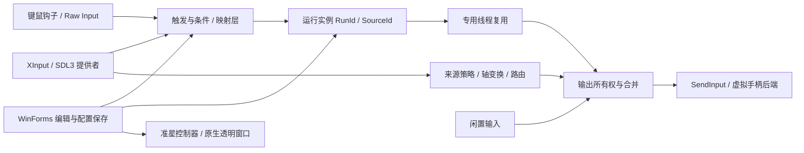

# 成熟工具对照、架构审查与性能改进

日期：2026-10-21—2026-10-22。基线：`ed90c74` / 本地 beta.14；改进目标：beta.15。
范围：已有键鼠宏、手柄输入/输出与窗口/无边框准星。保持功能冻结、配置兼容和轻量分发。
外部资料来自官方文档及项目源码；产品差距是结合当前源码作出的定性判断，未把网页宣传当成实测，也未给出虚构的完成百分比。

## 结论

日常“创建宏 → 设置触发 → 编辑步骤 → 保存 → 运行/停止”的能力已经完整，用户长期使用的
1.4.3 仍是稳定性基线。下一阶段收益最大的工作是减少后台无效工作、把运行协调与界面进一步解耦、
保持明确的运行状态和持续自动验收。现在没有证据支持更换 UI 框架、重写执行器或扩展到通用自动化平台。

对照成熟工具，我们在硬件覆盖、配置示意/概览、丰富上下文和生态上仍有差距；在本产品定位下，
不必逐项追齐。输出所有权、独立运行实例、紧急停止和原子配置保存已经是值得保留的基础。
这说明我们有明确、可验证的安全语义，并不证明其他工具没有类似保障。

## 同类工具：值得学什么，还有什么差距

| 工具与官方证据 | 成熟做法 | InputStitch 当前差距和取舍 |
|---|---|---|
| [JoyToKey 基本流程](https://joytokey.net/en/overview)、[高级映射](https://joytokey.net/en/advanced) | 配置与按钮映射直接对照，设置向导，按目标程序切换配置 | 我们已有快捷创建、步骤与目标条件；配置概览和“当前到底会做什么”还可继续打磨。自动按程序切换整套配置不是现成功能，先不补。 |
| [reWASD 工作区](https://www.help.rewasd.com/interface/workspace.html)、[触发方式](https://help.rewasd.com/basic-functions/activators.html) | 设备/映射可视对应、展开查看全部触发映射、配置层级清楚 | 我们已有长按、双击、松开等触发和映射层，基础语义不是空白；设备图到映射的概览、解释和硬件专属能力仍更浅。优先减少理解成本。 |
| [AutoHotkey 线程语义](https://raw.githubusercontent.com/AutoHotkey/AutoHotkeyDocs/v2/docs/misc/Threads.htm)、[定时器语义](https://raw.githubusercontent.com/AutoHotkey/AutoHotkeyDocs/v2/docs/lib/SetTimer.htm) | 强脚本表达力，明确说明定时精度、打断和运行限制 | 我们的表达力较窄；但无需脚本的有限宏流程正是定位。AHK 的“线程”主要是可打断的模拟线程，不能直接用它替换当前独立 RunId/SourceId 的并发执行。 |
| [Pulover's Macro Creator](https://www.macrocreator.com/features/) | 录制、循环/条件、窗口/控件、图像像素、变量等桌面自动化 | 我们已有录制、重复和条件，但没有整套桌面自动化语言。这是产品范围差异，现阶段不追图像/OCR、变量或任意脚本。 |
| [Joystick Gremlin](https://github.com/WhiteMagic/JoystickGremlin) | 任意摇杆、轴变换、模式继承、宏和 Python 扩展 | 我们已有 SDL3、身份/来源策略、死区/曲线/缩放及条件，旧策略文档中的“尚无变换层”已过时。硬件广度、继承/脚本生态仍有差距；新增后端应走现有接口。 |
| [Steam Input 映射层](https://partner.steamgames.com/doc/features/steam_controller/action_set_layers) | 绑定复用、按状态切换，官方同时强调多层顺序/复杂性风险 | 学习状态可解释、按变化更新的做法；不把任意多层堆叠作为目标。保持现有可预测的切层、释放与停止规则。 |
| [AntiMicroX](https://github.com/AntiMicroX/antimicrox)、[输入线程](https://raw.githubusercontent.com/AntiMicroX/antimicrox/master/src/inputdaemon.cpp)、[精确定时](https://raw.githubusercontent.com/AntiMicroX/antimicrox/master/src/sdleventreader.cpp) | SDL 输入线程与图形界面分工，精确定时与事件处理结合 | 我们已有专用输入线程，但状态轮询中仍混入不必要的拓扑/元数据工作。借鉴分工原则，保留自己的所有权模型；项目目前自述维护资源有限，不能仅凭“成熟”二字选依赖。 |

未在同一台机器、相同映射和硬件下运行这些竞品，因此不声称 InputStitch 比它们省多少 CPU、低多少延迟或更稳定。

## 现有架构与边界

- 输入、虚拟输出、来源策略、轴变换、持久身份已有接口或独立模块；生产源清单统一为 55 个文件，构建/测试/来源包共用并有漂移检查。
- 所有持久输出仍经 `OutputOwnershipManager`，独立源停止不会释放别人的输出；后端异常走 fail-closed 清理。
- 配置经过暂存、解析验证、同卷替换及备份。不能为节省少量分配去掉快照、验证或所有权隔离。
- 准星是小型原生分层窗口，按设置/显示器变化重绘，不是全屏每帧重画。保持窗口/无边框范围；未重新引入 Game Bar 或独占全屏方案。
- 历史架构文档的 F3 清单问题已解决，F6 已有 XInput + SDL3 + Composite；不能继续把旧未完成项当作当前缺陷。

## 本轮发现与已实施的修正

### 1. 空 XInput 槽位高频读取：实际资源热点

此前每个输入周期查询全部非自有槽位。微软明确建议不要每帧查询空槽位，应间隔几秒检查新设备：
[Getting Started With XInput](https://learn.microsoft.com/en-us/windows/win32/xinput/getting-started-with-xinput)。

修正：已连接设备仍每轮读取，空槽位每 500 ms 重试。首次观察、断开释放、重连基线和自有虚拟槽位排除保持原语义；
自有槽位发生变化时立即失效等待。代价是新插入/重新连接的 XInput 手柄通常最多约半秒被发现，加上当时系统调度延迟；
已连接设备的输入、释放及键鼠宏不经过这个等待。假时钟测试直接覆盖 499/500 ms 边界、断开、重连及排除。

### 2. 专用调度器未真正等待截止时间

原循环最多等待一段 8 ms 后就执行下一轮。100 ms 测试实际约 64.4 次/秒；10 ms 表面频率接近目标，
也不能证明每次间隔都正确。修正为单调时钟截止时间、可中断等待、慢回调不积压补发。

Windows 10 1803+ 使用系统的每对象高精度等待计时器，避免忙等及更改全局计时分辨率：
[CreateWaitableTimerExW](https://learn.microsoft.com/en-us/windows/win32/api/synchapi/nf-synchapi-createwaitabletimerexw)、
[SetWaitableTimer](https://learn.microsoft.com/en-us/windows/win32/api/synchapi/nf-synchapi-setwaitabletimer)。
不支持时回退到可中断的框架等待；回退路径有强制测试，旧 Windows 上的实际计时粒度仍由系统决定。
精度不是零成本：空回调微基准中高精度 10 ms 路径的 CPU 时间略增，不能把局部调度改动单独宣传为省 CPU。
成品整体收益主要来自去除无效读取和界面工作。

### 3. 不变的设备拓扑仍在每轮重建

Composite 每轮读取子提供者的设备数组、清空并重建 owner map；对外读取又创建/排序列表。
改为检查每个子提供者的 `TopologyVersion`，只在变化时重建，原子发布完整快照；对外仍返回独立数组，避免调用者改坏缓存。
每轮状态和边沿读取不跳过。测试覆盖连接/断开、相同版本总和、重复索引、外部数组修改、刷新失败不发布半成品及重试。
接口现在明确要求成员/索引所有权变化推进拓扑版本，后续新增提供者可以直接遵守这个边界。

SDL3 对已接入的设备也先检查成员，再读取描述信息，避免每 10 ms 重新查名称、路径等稳定元数据；状态和边沿继续更新。

同时核对了所用 [SDL3 release-3.4.16 的官方实现](https://raw.githubusercontent.com/libsdl-org/SDL/release-3.4.16/src/joystick/SDL_gamepad.c)：
`SDL_UpdateGamepads` 内部已经调用 `SDL_UpdateJoysticks`。此前两个入口都调用，实际重复更新。
现在优先调用 Gamepads 一次，缺失时才走 Joysticks 备用入口，另有调用次数回归检查。

最后核对原生内存所有权时，发现 `SDL_GetGamepads` 的空设备数组同样属于调用者，
[官方要求使用 SDL_free 释放](https://wiki.libsdl.org/SDL3/SDL_GetGamepads)。原包装在数量为零时从 `try/finally` 之前返回，
会漏掉非空指针。已将零数量返回放到释放作用域之内；5,000 次空数组分配/释放，以及非空数组和空指针分支分别检查。
这是无手柄场景的原生内存缺陷，不能依赖托管 GC 回收，也不应被有手柄的短时采样掩盖。

### 4. 空闲高级触发仍向 UI 投递任务

没有任何高级触发状态时仍反复投递 `BeginInvoke`，随后创建空结果列表。
现在在入口检查已有的线程安全 `TrackedCount`；待处理触发仍正常排队、合并和派发。
独立集成测试覆盖空闲、待处理和清空三个阶段。未更改长按/双击/条件的执行语义。

### 5. 持续运行采样强制 GC

旧验收在暖机和结束时强制回收，会使资源曲线比真实运行更好看。本轮删除强制回收，报告显式写入 `forcedGc=false`。
第一次不强制回收的 10 分钟运行触发了原有“结束单点句柄数 +32”断言；失败记录保留，未计入通过。
随后用完全不含产品代码的最小 .NET 线程复现：创建并 Join 1,000 个空线程后，存活线程仍为 6，
尚无 Gen0 回收时句柄由 221 增至约 5,240。结合持续采样中的升降，说明 CLR 线程记账对象的自然回收批次
会影响计数，不能用一次强制回收或任意结束瞬间来判定泄漏。

第二次增加稳态窗口对照后仍触发增长检查，因此没有把改变统计口径当作解决办法。
本轮进一步实施下述专用线程复用，并**恢复原来的结束瞬间 +32 句柄限制**。
同时保留暖机后 30–90 秒与最后一分钟的中位数增长 +32、采样峰值 +256、GDI/USER 结束增长各 +8 的额外检查。
保留原始结束值、全部曲线和线程数，不等待 GC 恰好发生、不人为制造回收；资源检查前先保存 `MEASURED` 报告，
避免失败时丢失关键指标。最终代码重新进行 10 分钟验收，前两次失败不计入通过。

成品资源采样使用独立、最小的 C# 宿主加载真实 EXE 的生产启动路径、SDL3、钩子和定时器；路径全部隔离，禁用宏和虚拟输出。
初步 PowerShell UI 回调宿主的采样保留为探索记录，不混入最终比较。内存报告区分私有内存、下载大小，不把压缩 EXE 当作 RAM。

### 6. 反复启停创建新线程：实施专用执行线程复用

新增独立的 `MacroWorkerPool` 与逐运行的 `MacroWorkItem` 完成对象。每个正在执行的宏仍占用独立专用线程；
已空闲的线程可以承接下一次运行，最多保留 4 个休眠备用线程。没有全局并发数限制，也不把长时宏塞进共享 CLR 线程池。
每次启动继续创建新的 RunId、SourceId、配置快照和停止信号，复用线程不复用这些运行状态。

配置切换等待运行完成对象，关闭时取消各运行并在原有有界时间内关闭专用线程；孤立测试窗口 Dispose 也清理线程。
这把线程生命周期、空闲缓存和完成等待集中到一个可独立测试的模块，减少 MainForm 对物理线程退出的依赖。
新增 1,010 项工作线程检查，并用实际 MainForm 的连续重启、两个来源共享按键、停止其中一个、切换配置测试执行边界。
新持续运行检查还要求整个过程创建的宏工作线程不超过 6 个，避免用 GC 回收掩盖线程反复创建。

最终代码的 600.1 秒持续验收通过：6,939 轮，宏工作线程共创建 3 个；句柄基线 368、结束 371、采样峰值 371；
GDI 26→26、USER 30→30；私有内存基线 34,230,272 B、结束 35,688,448 B。
键盘按下/释放 26,571/26,571，最终来源和按住输出均为零；没有强制 GC。它是十分钟有界证据，不是整夜或全部设备稳定性的证明。

## 对照实测

同机 Windows / .NET Framework，16 个逻辑处理器，检测到 1 个手柄来源；启动后先暖机 5 秒，再分别约 30 秒采样。
CPU 表中为**单个核心的占用比例**，不是整机百分比。短测用于定位浪费，不代表所有设备和负载。

| 真实成品路径，最小宿主 | beta.14 | beta.15 | 变化 |
|---|---:|---:|---:|
| 空闲，准星关闭，单核 CPU | 23.229% | 4.269% | 约降低 82% |
| 空闲，准星开启，单核 CPU | 23.188% | 3.905% | 约降低 83% |
| 空闲，准星关闭，末次私有内存 | 40,513,536 B | 40,177,664 B | 基本相当，不宣称普遍节省 |
| 空闲，准星开启，末次私有内存 | 41,091,072 B | 40,091,648 B | 小幅下降，不宣称普遍节省 |

百万轮不变拓扑微基准，三次独立样本：旧版每次 2,000,000 次子提供者快照、10 次 Gen0 回收；
改进后两项均为零，原有状态轮询次数不减少。最终源采样的耗时中位数由约 224 ms 降至约 50 ms。
这只是合并层局部结果，不是整套软件提速四倍。最终采样时另有持续运行验收在后台，
短循环 CPU 时间还受系统计费粒度影响，因此不将其当作跨设备性能保证。

最终回归、持续运行和成品启动的原始记录及版本/哈希见交付目录的 `verification.json`。
最终 EXE 仍为原生 WinForms + .NET Framework 单文件分发，不增加第三方运行依赖。

最终自动化结果：34 套回归全部通过；6,623 项产品流程断言、303,716 项输出所有权断言、
172 项准星检查、70,499 项布局检查（188 个窗口，零问题）；77 项隔离真实输出检查通过，
x64/x86 成品启动、原生缓存提取/复用/修复、准星恢复与正常退出均通过。

真实输出验收曾发现用户的 beta.14 仍在运行，因此排除当时的通过记录，并补上发出输入之前的
进程预检（同时识别带版本号的便携程序）。得到用户授权后，正常关闭旧版，再重新通过全部 77 项。
先前旧版运行期间，测试虚拟设备出现后，正常设备清单缓存发生刷新；宏配置文件始终未变。
没有覆盖用户设备清单。最终隔离重跑前后，正常宏配置和设备清单的哈希均未变，详见交付记录。

轻量化要同时看下载、落盘和运行：x64 EXE 为 1,984,000 B，比 beta.14 增加 22,528 B（约 1%）；
本轮新增 Windows 等待入口使 CLR 字符串元数据跨过 64 KiB 索引边界，增量大部分来自元数据索引变宽，
并非引入大型运行库。不通过混淆命名来压回边界。启用 SDL3 后还会复用每架构的原生缓存：
x64 `SDL3.dll` 为 2,844,160 B，x86 为 2,358,784 B；其大小本轮未增加。
不能把约 1.98 MB 的下载包误称为全部落盘空间，更不能把它当作运行内存。

## 未关闭的架构债务及后续顺序

| 优先级 | 现状/证据 | 下一步及验收条件 |
|---|---|---|
| P1：界面与运行协调解耦 | `InputStitch.cs` 仍约 8.1 千行；MainForm 仍负责捕获、调度协调、保存和执行。专用线程生命周期现已独立，但 partial 和这次提取没有完全解除依赖 | 下一次维护执行路径时，继续把运行协调提取为可注入服务，界面只发命令/显示状态；一次移动一个职责。保持 RunId、停止、UI 保护及旧 XML 回归。避免一口气重写。 |
| P1：高级触发依赖 UI 派发 | 输入线程已有独立节奏，但高级触发决策通过合并后的 UI 回调执行；界面长时间阻塞仍会影响长按阈值/条件处理 | 加入有 UI 阻塞的端到端延迟样本，再决定把纯决策移出 UI；开始/停止等操作仍遵守线程与 UI 安全边界。不因局部算法测试通过就宣布延迟解决。 |
| P1：性能基线可持续复测 | 以前重 UI 布局和输出正确性，缺少成品空闲资源对照；本轮补上 | 将本轮脚本作为重复基线；后续增加同机对照、托盘/无设备/多设备、设置预览、运行和停止的资源预算。先记录趋势，再设与硬件无关的可靠门槛。 |
| P2：SDL3 热路径分配 | 每轮仍枚举设备、创建边沿/存在集合与状态快照；抑制的 Xbox 来源仍要判断 | 先剖析各阶段耗时，随后考虑热插拔事件与稳定成员缓存、复用可控缓冲；遵守 SDL 的线程要求。不能为了少分配吞掉断开释放或复用对外可变对象。 |
| P2：大规模执行与合并 | 本轮已消除通常反复启停时的新建线程；大量同时运行的宏仍各用线程。所有权每次变化克隆/重算，未给出上百并发宏的负载证明 | 按实际常用与更高负载的 p95/p99、线程/分配判断是否需要异步调度或增量合并。保留当前独立取消和输出模型，不直接用阻塞共享线程池替换长时间运行的宏。 |
| P2：后端生命周期 | 已有 `IVirtualGamepadBackend`，生产仍用 ViGEm；[上游已归档](https://github.com/nefarius/ViGEmBus) | 保留兼容后端及键鼠无驱动模式。替换后端需先验证维护、许可证、x86/x64、部署和故障恢复，再做 opt-in 适配；当前不换驱动。 |
| P2：字符串与维护文档 | 中英文仍大量内联，旧策略里混有已完成/待实现的叙述 | 新一轮文案维护时按窗口集中资源，序列化字段不改名。当前文档增加明确的现状入口，历史调研保留日期。 |
| 产品发布准备 | 尚未借本轮解决签名、支持范围与项目许可证决策 | 功能稳定后单独整理正式发布、更新迁移和签名；许可证不由一次性能修复代选。 |

第一批继续做性能基线和小范围解耦，其次把“当前配置/触发/输出状态”解释清楚。
只有实际用户流程提出需求，才评估程序配置自动切换、更多硬件专属能力或脚本；这些都不属于当前实施清单。
不引入 Electron/WebView、插件框架、后台服务、管理员常驻或新的遥测平台。

## 重复验证入口

- `tests/Run-Tests.ps1`：全部回归，含调度、提供者、所有权、真实窗口流程及布局。
- `tests/Run-Performance.ps1 -Label <name>`：三个重复样本，调度/拓扑微基准，无钩子、设备输出、用户配置或强制 GC。
- `tests/Run-ResourceProbe.ps1 -Package <x64-exe> -Label <name> -Seconds 30`：成品路径暖机后，准星关闭/开启各一阶段；全部应用路径隔离，宏禁用，SDL3 开启。
- `tests/Run-ProductAcceptance.ps1 -SoakMinutes <minutes>`：持续宏、反复开始/停止、编辑保存及最终清理，不强制 GC。
- `tools/InputLab/run-acceptance.ps1 -AllowRealOutput`：实际 SendInput 与 ViGEm/XInput；与图形流程测试顺序运行。
- `tests/Run-PackagedSmoke.ps1 -Architecture x64|x86`：最终成品提取、缓存复用/修复、原生运行库、窗口和准星恢复、退出清理。

自动化结果是本轮验收依据，人工试用继续作为可选体验反馈。
